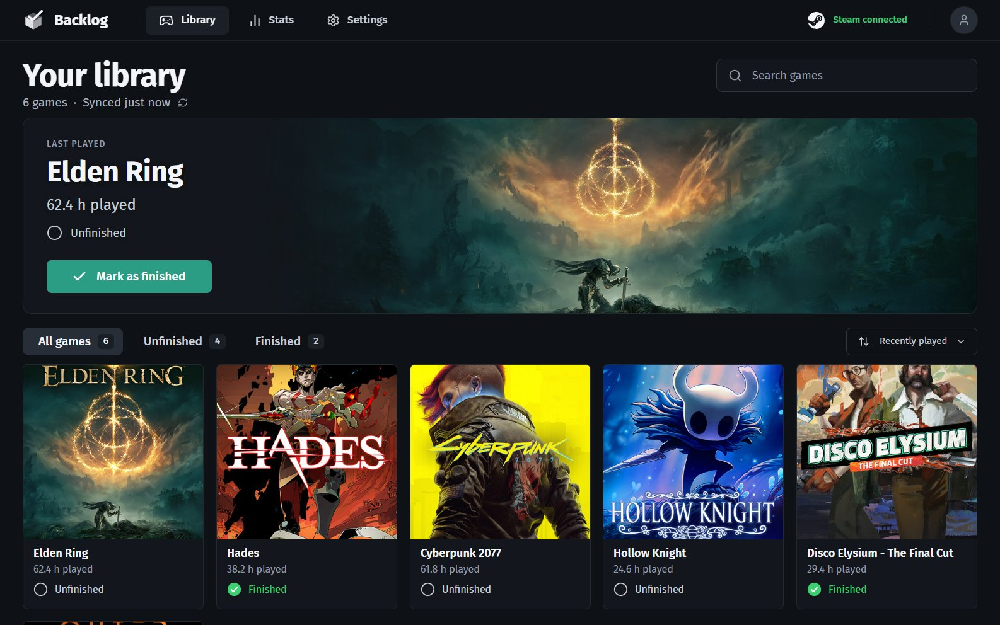

# Steam Backlog

A local web app for working through your Steam backlog. It pulls your games, playtime and cover art from
Steam, and you mark each game Finished or Unfinished.



## Features

- **Library**: every game as a cover tile, with the one you played last at the top. Filter by all,
  unfinished or finished, sort by recent play, playtime or name, and search.
- **Stats**: completion by games and by hours, a playtime histogram, your most played games and how many you
  finished each month.
- **Settings**: your Steam connection, sync options and where your data lives.
- **Easy connect**: it finds the Steam accounts signed in on your PC, so you pick yours and paste an API key.
- **Local only**: everything runs on your computer. The server listens on `127.0.0.1`, and your API key and
  marks are only ever sent to Steam.

## Run it

You need [Node.js](https://nodejs.org/) 22.22 or later.

```bash
git clone https://github.com/limbon2/steam-backlog.git
cd steam-backlog
npm install
npm start
```

Then open http://localhost:4777.

## Connect Steam

1. Get a Steam Web API key at https://steamcommunity.com/dev/apikey. Sign in, enter `localhost` as the
   domain name, and copy the 32-character key.
2. Open Steam Backlog. It lists the Steam accounts that have signed in to the Steam client on this PC. Pick
   yours, or paste your profile URL, custom URL name or SteamID64.
3. Paste the key and press **Connect Steam**.

If Steam returns no games and the key belongs to a different account, set **Steam → Privacy Settings → Game
details** to **Public**.

The app syncs when it opens (if the last sync is over 15 minutes old) and whenever you press the sync button
next to "Synced …".

## Where the data and images come from

- **Games, playtime, last played**: `IPlayerService/GetOwnedGames` in the
  [Steam Web API](https://steamcommunity.com/dev).
- **Artwork**: Steam's public store API (`IStoreBrowseService/GetItems`, no key needed), loaded straight from
  Steam's CDN.
  - Tiles use the game's vertical capsule, which crops to a square without losing the logo.
  - Games without one show their library cover whole, over a blurred copy of itself.
  - The **Last played** banner is the game's logo-free library hero, the same one the Steam client shows.
- **Your marks**: `data/backlog.json`, together with your Steam connection and cached artwork links. The folder
  is git-ignored. Back it up to keep your marks. Disconnecting Steam keeps them. Set `BACKLOG_DATA_FILE` to
  keep the file somewhere else.

## Development

```bash
npm run dev
```

Then open http://localhost:5173. The UI reloads as you edit, and the API restarts when a server file changes.

| Command | What it does |
|---|---|
| `npm run dev` | API on port 4777 plus the Vite dev server on 5173 |
| `npm start` | Builds the UI and serves the app and API on port 4777 |
| `npm test` | Unit tests (Vitest) |
| `npm run typecheck` | TypeScript checks for the UI and the server |
| `npm run build` | Typecheck, then build the UI into `dist/` |

Set `BACKLOG_PORT` to use a port other than 4777.

```
shared/   types and helpers used by both sides (Steam input parsing, display names)
server/   Hono API: Steam Web API client, local Steam account detection, sync, JSON storage
src/      React UI: pages, components, hooks, and pure logic in src/lib
```

Built with React, TypeScript, Vite, TanStack Query and Hono.

## License

Copyright (C) 2026 limbon2

This program is free software: you can redistribute it and/or modify it under the terms of the GNU General
Public License, version 3, as published by the Free Software Foundation. It is distributed in the hope that it
will be useful, but WITHOUT ANY WARRANTY. See [LICENSE](LICENSE) for the full text.

Steam Backlog is not affiliated with or endorsed by Valve Corporation. Steam and the Steam logo are trademarks
of Valve Corporation. Game artwork belongs to its respective owners. The app loads it from Steam at runtime,
and the screenshot above shows it only to illustrate the app.
